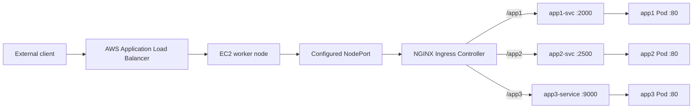

# Kubernetes Multi-App Ingress Lab

A project-based Kubernetes lab showing how three small web applications can be built as container images and routed through Kubernetes Services and an NGINX Ingress Controller.

The repository documents a self-managed cluster bootstrapped with kubeadm on AWS EC2. Its current manifests describe the intended configuration; they do not prove that the cluster or AWS resources are running now.

## Architecture



The intended path is client → ALB → worker-node NodePort → NGINX Ingress → Service → Pod. Configure the Ingress Controller Service and the ALB target group to use the same NodePort; this repository does not include that controller Service configuration. Ingress has no host restriction, so it does not depend on an ALB DNS name.

## Cluster setup

- Kubernetes: `v1.37.1`
- Bootstrap: kubeadm
- Runtime: containerd
- Pod network: Flannel
- Ingress: NGINX Ingress Controller, installed with Helm
- External entry point: AWS Application Load Balancer targeting the Ingress Controller's configured NodePort

Flannel is the CNI recorded for this lab. The reason it was selected was not documented. Calico is not part of this cluster configuration.

## Applications and routes

| Route | Deployment | Service | Service port | Container port |
|---|---|---|---:|---:|
| `/app1` | `app1` | `app1-svc` | 2000 | 80 |
| `/app2` | `app2` | `app2-svc` | 2500 | 80 |
| `/app3` | `app3-deployment` | `app3-service` | 9000 | 80 |

Each application is a neutral static demo page built from its Dockerfile. The Ingress rewrite sends each route to the application's root page.

## Build and load the application images

The manifests use local image names `app1:v1`, `app2:v1`, and `app3:v1`. Build them from this repository:

```bash
for app in app1 app2 app3; do
  docker build --tag "$app:v1" "./$app"
  docker save --output "$app.tar" "$app:v1"
done
```

Copy each generated archive to every Kubernetes node that may run the application Pod, then import it into containerd's Kubernetes namespace:

```bash
scp app1.tar app2.tar app3.tar <user>@<node>:/tmp/
ssh <user>@<node> 'for image in /tmp/app1.tar /tmp/app2.tar /tmp/app3.tar; do sudo ctr -n k8s.io images import "$image"; done'
```

Repeat for each eligible node. The generated archives are local deployment artifacts and are ignored by Git. The older committed OCI exports were removed from this branch because their page contents did not match the current source; rebuild them from the Dockerfiles above before using the updated manifests.

## Apply the manifests

Review the cluster context and AWS security groups before applying any changes. Install the NGINX Ingress Controller with Helm if it is not already present:

```bash
helm upgrade --install ingress-nginx ingress-nginx \
  --repo https://kubernetes.github.io/ingress-nginx \
  --namespace ingress-nginx \
  --create-namespace
```

Apply the application resources:

```bash
kubectl apply -f app1/deployment-app1.yml
kubectl apply -f app2/deployment-app2.yml
kubectl apply -f app3/deployment-app3.yml
kubectl apply -f ingress.yaml
```

Configure the ALB target group to reach the worker nodes on the NodePort assigned to the Ingress Controller Service. The previous hostname recorded in the repository no longer resolves; use the DNS name from the ALB you control.

## Validation

GitHub Actions builds all three images and runs Kubeconform in strict mode against the Deployments, Services, and Ingress. These are CI checks; they are not a live cluster deployment test.

Useful cluster checks after deployment:

```bash
kubectl get nodes -o wide
kubectl get pods -A -o wide
kubectl get services -A
kubectl get ingress -A
kubectl describe ingress multi-app-ingress
```

Open the three routes using the current ALB DNS name:

```text
http://<ALB-DNS>/app1
http://<ALB-DNS>/app2
http://<ALB-DNS>/app3
```

## Screenshots

The previous browser captures showed personal demo content, an unsupported production-status claim, or host/network details, so this branch omits them. Capture fresh evidence after redeploying the updated images. See [the screenshot checklist](docs/screenshots/README.md).

## Limitations

- No AWS resources were changed by this repository update.
- No live Kubernetes cluster was available for deployment verification.
- The ALB DNS name must be confirmed by the project owner before use.
- Screenshots are evidence to collect after a real deployment; none are fabricated or presented as current.

## Repository metadata suggestions

- Description: A Kubernetes lab routing three neutral web applications on AWS EC2 with kubeadm, containerd, Flannel, NGINX Ingress, Helm, NodePort, and an Application Load Balancer.
- Topics: `kubernetes`, `kubeadm`, `containerd`, `flannel`, `ingress-nginx`, `helm`, `aws`
